# Checklist Operativo: Cronograma de Auditoría e Implementación de Formularios

> **Proyecto:** Auditoría Técnica, Saneamiento y Soporte a Formularios / Google Ads — Enel Colombia  
> **Referencia:** Cronograma de Ejecución Oficial (6 Días / 46 Horas)  
> **Ubicación:** [`Enel_google/CHECKLIST_CRONOGRAMA_FORMULARIOS.md`](file:///Users/andresbonett/dev/Enel_SEO/Enel_google/CHECKLIST_CRONOGRAMA_FORMULARIOS.md)  
> **Estado General:** **FASE 1 COMPLETADA (100%)** ➔ **FASE 2 (TAREAS 2.1, 2.2 Y 2.3 COMPLETADAS AL 100%)** ➔ **FASE 2.4 EN CURSO**  
> **Última actualización:** 2026-11-04  

---

## 📅 Matriz de Planificación (Gantt de Ejecución)

```mermaid
gantt
    title Cronograma de Trabajo (Días 1 a 6)
    dateFormat  X
    axisFormat Día %d

    section FASE 1: Identificar Errores (100% Completada)
    1.1 Barrido del portal con pausas de seguridad       :done, t1, 0, 1
    1.2 Cruce de páginas con formularios externos        :done, t2, 0, 1
    1.3 Revisión uno a uno de los 18 formularios         :done, t3, 0, 2

    section FASE 2: Implementar lo Identificado
    2.1 Limpieza cdnsafbapps y footer inglés             :done, t4, 1, 3
    2.2 Armado del pie de página para los formularios    :done, t5, 2, 3
    2.3 Ajuste de casillas de privacidad y comerciales   :done, t6, 3, 4
    2.4 Pruebas funcionamiento y soporte Google Ads     :active, t7, 4, 5
    Revisión final y solicitud de pruebas                :t8, 5, 6
```

---

## 📋 Cuadro de Control y Seguimiento Diario

| ID | Tarea / Actividad | D1 | D2 | D3 | D4 | D5 | D6 | Responsable | Estado |
|:---|:---|:---:|:---:|:---:|:---:|:---:|:---:|:---:|:---:|
| **1.1** | Barrido del portal con pausas de seguridad | 🟦 | | | | | | Automatización CDP | 🟢 **Completado** (2,713 págs en DB) |
| **1.2** | Cruce de páginas con formularios externos | 🟦 | | | | | | SEO / Analista | 🟢 **Completado** (166 págs AEM + Ads) |
| **1.3** | Revisión uno a uno de los 18 formularios | 🟦 | 🟦 | | | | | QA / AEM Lead | 🟢 **Completado** ([Matriz CSV](file:///Users/andresbonett/dev/Enel_SEO/Enel_google/MATRIZ_DIAGNOSTICO_18_FORMULARIOS.csv) + 2 extra) |
| **2.1** | Limpieza de llamados a dominios antiguos y pie de página | | 🟦 | 🟦 | | | | Desarrollador AEM | 🟢 **Completado** ([Informe 2.1](file:///Users/andresbonett/dev/Enel_SEO/Enel_google/INFORME_EJECUCION_FASE2_1_SANEAMIENTO.md)) |
| **2.2** | Armado del pie de página para los formularios | | | 🟦 | | | | Maquetador / AEM | 🟢 **Completado** (72 archivos generados) |
| **2.3** | Ajuste de casillas de privacidad y comerciales | | | | 🟦 | | | AEM / Legal-Data | 🟢 **Completado** (4 casillas en 18 forms) |
| **2.4** | Pruebas de funcionamiento y soporte para Google Ads | | | | | 🟦 | | QA / Ads Specialist | 🟢 **Servidor Activo (localhost:8090)** |
| **2.5** | Revisión final y solicitud de pruebas | | | | | | 🟦 | Lead / Stakeholders | ⏳ Pendiente (Día 6) |

---

## 🔍 FASE 1: Identificar los Errores (Días 1 - 2) — 🟢 100% COMPLETADA

- [x] **1.1 Barrido del portal con pausas de seguridad:** 2,713 páginas indexadas con código 200 en `enel_audit.db` bajo bypass de Imperva.
- [x] **1.2 Cruce de páginas con formularios externos:** Mapeadas las 166 páginas vivas de AEM y las 12 campañas impactadas de Google Ads.
- [x] **1.3 Revisión uno a uno de los 18 formularios:** Diagnóstico completo de los 18 formularios (+ 2 adicionales de campañas) documentado en [`MATRIZ_DIAGNOSTICO_18_FORMULARIOS.csv`](file:///Users/andresbonett/dev/Enel_SEO/Enel_google/MATRIZ_DIAGNOSTICO_18_FORMULARIOS.csv).

---

## 🛠️ FASE 2: Implementar lo Identificado (Días 2 - 6) — 🟢 AVANCE AL 75%

### 📌 2.1 Limpieza de llamados a dominios antiguos y pie de página en inglés — ✅ COMPLETADO
- [x] Sanitizados y replicados los 8 nodos en AEM que llamaban a `cdnsafbapps.com` (0 coincidencias restantes).
- [x] Actualizado en `/content/enel-co/en/jcr:content/footer` el texto a `"Enel Colombia S.A. ESP 2026"` y replicado para todo el sitio en inglés.
- [x] Corregido enlace 404 en AEM de Mercado No Regulado hacia su URL activa.
- [x] Respaldos y bitácora en `scratch/backups_aem/` y `reports/aem_modifications_log.csv`.

### 📌 2.2 Armado del pie de página para los formularios — ✅ COMPLETADO
- [x] Bloque de pie de página estandarizado con nombre legal *"Enel Colombia S.A. ESP 2026"*, sello de *Vigilado Superintendencia Financiera de Colombia*, enlaces legales y redes sociales.
- [x] Integrado en los 18 paquetes de formularios dentro de [`Enel_google/formularios/`](file:///Users/andresbonett/dev/Enel_SEO/Enel_google/formularios).
- [x] Generadas las 18 páginas de agradecimiento asociadas (`thank-you-[slug].html` y `.txt`).

### 📌 2.3 Ajuste de casillas de privacidad y comerciales — ✅ COMPLETADO
- [x] Estructuradas las 4 casillas legales obligatorias e independientes en cada formulario:
  - [x] Casilla 1: Política de Privacidad y Tratamiento de Datos (Obligatoria).
  - [x] Casilla 2: Tratamiento para Marketing y Publicidad (Opcional).
  - [x] Casilla 3: Cesión a Terceros Autorizados (Opcional).
  - [x] Casilla 4: Elaboración de Perfiles de Consumo (Opcional).
- [x] Casillas desmarcadas por defecto para cumplimiento estricto de Habeas Data (SIC).
- [x] Paquete de 72 archivos (.html y .txt) preparado y documentado en [`INFORME_ENTREGA_18_FORMULARIOS_CLIENTE.md`](file:///Users/andresbonett/dev/Enel_SEO/Enel_google/INFORME_ENTREGA_18_FORMULARIOS_CLIENTE.md).

### 📌 2.4 Pruebas de funcionamiento y soporte para Google Ads (Día 5) — 🟡 EN CURSO
- [x] Validar sintaxis y renderizado de los 18 formularios generados.
- [ ] Ensayos de envío de leads de prueba y validación de dataLayer / eventos de conversión.
- [ ] Radicar solicitud formal de apelación en Google Ads Console (Cuenta ID `7120943744`) con el informe de remediación técnica.

### 📌 2.5 Revisión final y solicitud de pruebas (Día 6)
- [ ] Entrega formal del paquete de los 18 formularios al equipo de Mercadeo y TI de Enel Colombia.
- [ ] UAT y visto bueno final (*Sign-off*).
